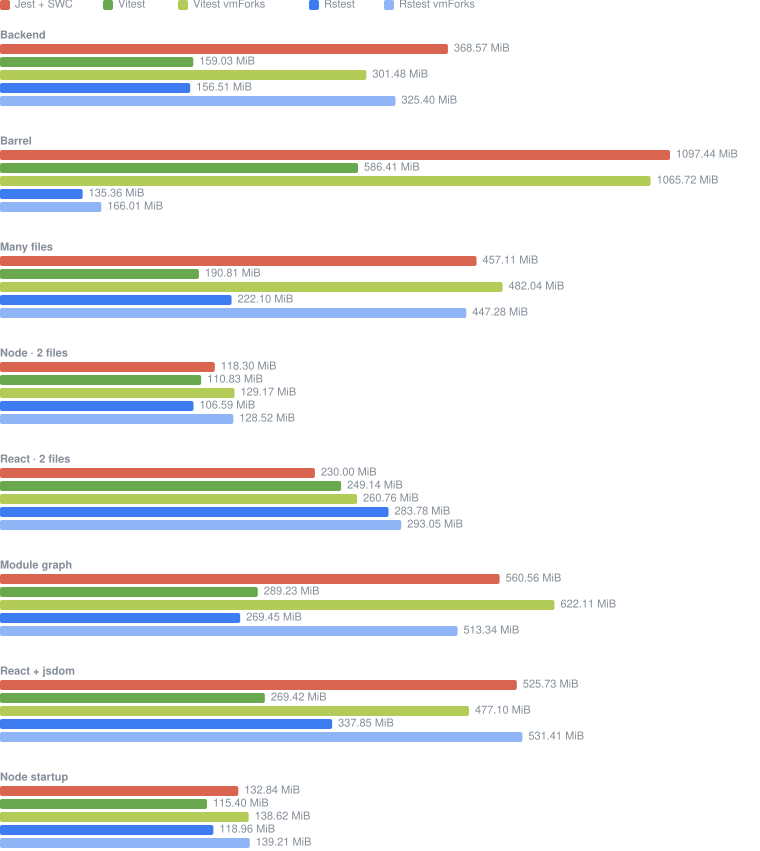
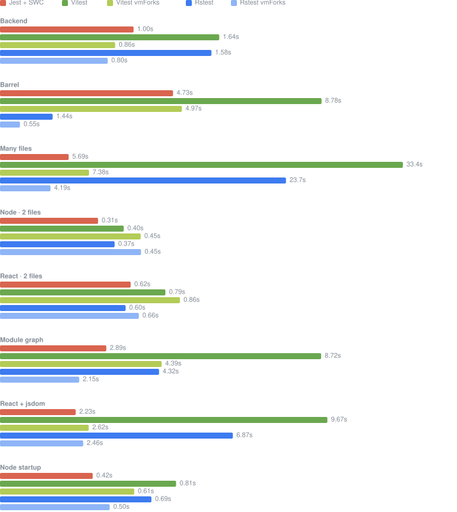
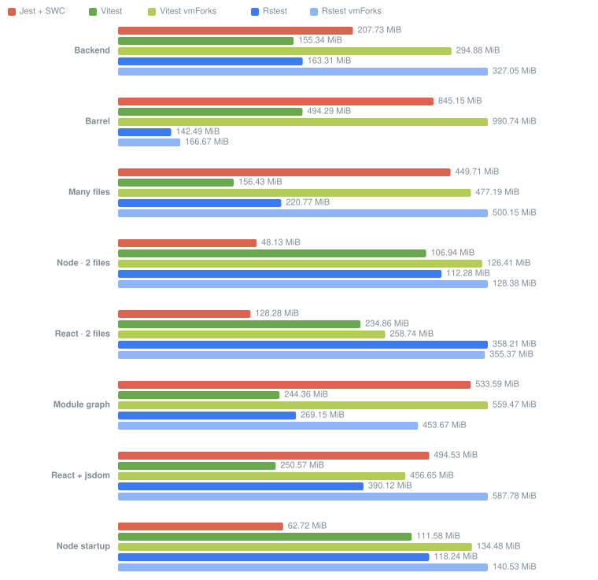

# Rstest benchmarks

Median elapsed time and memory of Jest + SWC, Vitest and Rstest on shared Node and React workloads. The `vitest-vmForks` and `rstest-vmForks` runners add VM forks pools to the comparison. Each run reports whole-process elapsed time and process-tree memory for cold and warm framework caches.

For comparisons between Rstest releases or a local checkout, see [Rstest version benchmark](versions/README.md).

## Results

In each row the best (lowest) value is bold and the other cells show the difference from it. Differences do not indicate statistical significance. This publication covers the main and browser suites; cross-framework coverage is not included.

<!-- framework-results:start -->

Run [43817845441](https://github.com/rstackjs/rstest-benchmarks/actions/runs/43817845441) (attempt 1), commit `8fa5cbf` · 2026-11-16 · Apple M1 (Virtual), 3 CPUs, GitHub-hosted macOS runner image 20261104.0514.1, 20261112.0539.3 · Node v26.13.0 · jest **30.5.2**, vitest **5.1.0**, vitest-vmForks **5.1.0**, rstest **0.12.6**, rstest-vmForks **0.12.6**, @swc/jest **0.2.39**

Rstest source: `https://pkg.pr.new/@rstest/core@fe5e00a`. The run records its resolved versions and dependency lockfile.

### Elapsed time, cold cache


Within a case, bar length is proportional to the value. Across cases, the longest bar grows with the case's largest value on a log scale, so compare lengths only within a case.

| Case | Jest + SWC | Vitest | Vitest vmForks | Rstest | Rstest vmForks |
| --- | ---: | ---: | ---: | ---: | ---: |
| Backend | **1.03s** | 2.47s (+140%) | 1.36s (+32%) | 1.74s (+70%) | 1.14s (+11%) |
| Barrel | 12.2s (+1298%) | 18.1s (+1975%) | 14.8s (+1597%) | 1.79s (+105%) | **0.87s** |
| Many files | 5.77s (+45%) | 31.5s (+690%) | 8.39s (+110%) | 21.4s (+435%) | **3.99s** |
| Node · 2 files | 0.56s (+62%) | 0.43s (+26%) | 0.51s (+48%) | **0.34s** | 0.44s (+27%) |
| React · 2 files | 0.87s (+5%) | 0.87s (+5%) | **0.83s** | 0.93s (+12%) | 0.85s (+2%) |
| Module graph | 5.33s (+137%) | 11.5s (+410%) | 6.15s (+173%) | 4.48s (+99%) | **2.25s** |
| React + jsdom | 2.49s (+19%) | 9.20s (+341%) | 2.27s (+9%) | 6.70s (+222%) | **2.08s** |
| Node startup | 0.93s (+60%) | 0.88s (+52%) | 0.70s (+21%) | 0.77s (+32%) | **0.58s** |

### Memory, cold cache (MiB, peak process-tree footprint)



Within a case, bar length is proportional to the value. Across cases, the longest bar grows with the case's largest value on a log scale, so compare lengths only within a case.

| Case | Jest + SWC | Vitest | Vitest vmForks | Rstest | Rstest vmForks |
| --- | ---: | ---: | ---: | ---: | ---: |
| Backend | 369 (+135%) | 159 (+2%) | 301 (+93%) | **157** | 325 (+108%) |
| Barrel | 1097 (+711%) | 586 (+333%) | 1066 (+687%) | **135** | 166 (+23%) |
| Many files | 457 (+140%) | **191** | 482 (+153%) | 222 (+16%) | 447 (+134%) |
| Node · 2 files | 118 (+11%) | 111 (+4%) | 129 (+21%) | **107** | 129 (+21%) |
| React · 2 files | **230** | 249 (+8%) | 261 (+13%) | 284 (+23%) | 293 (+27%) |
| Module graph | 561 (+108%) | 289 (+7%) | 622 (+131%) | **269** | 513 (+91%) |
| React + jsdom | 526 (+95%) | **269** | 477 (+77%) | 338 (+25%) | 531 (+97%) |
| Node startup | 133 (+15%) | **115** | 139 (+20%) | 119 (+3%) | 139 (+21%) |

<details>
<summary>Warm cache</summary>

**Warm cache · Elapsed time**



Within a case, bar length is proportional to the value. Across cases, the longest bar grows with the case's largest value on a log scale, so compare lengths only within a case.

| Case | Jest + SWC | Vitest | Vitest vmForks | Rstest | Rstest vmForks |
| --- | ---: | ---: | ---: | ---: | ---: |
| Backend | 1.00s (+24%) | 1.64s (+104%) | 0.86s (+7%) | 1.58s (+96%) | **0.80s** |
| Barrel | 4.73s (+767%) | 8.78s (+1511%) | 4.97s (+811%) | 1.44s (+164%) | **0.55s** |
| Many files | 5.69s (+36%) | 33.4s (+698%) | 7.38s (+76%) | 23.7s (+466%) | **4.19s** |
| Node · 2 files | **0.31s** | 0.40s (+26%) | 0.45s (+43%) | 0.37s (+17%) | 0.45s (+44%) |
| React · 2 files | 0.62s (+4%) | 0.79s (+32%) | 0.86s (+43%) | **0.60s** | 0.66s (+11%) |
| Module graph | 2.89s (+34%) | 8.72s (+305%) | 4.39s (+104%) | 4.32s (+101%) | **2.15s** |
| React + jsdom | **2.23s** | 9.67s (+333%) | 2.62s (+17%) | 6.87s (+208%) | 2.46s (+10%) |
| Node startup | **0.42s** | 0.81s (+90%) | 0.61s (+45%) | 0.69s (+63%) | 0.50s (+18%) |

**Warm cache · Memory (MiB, peak process-tree footprint)**



Within a case, bar length is proportional to the value. Across cases, the longest bar grows with the case's largest value on a log scale, so compare lengths only within a case.

| Case | Jest + SWC | Vitest | Vitest vmForks | Rstest | Rstest vmForks |
| --- | ---: | ---: | ---: | ---: | ---: |
| Backend | 225 (+46%) | 156 (+1%) | 294 (+91%) | **154** | 324 (+111%) |
| Barrel | 851 (+517%) | 493 (+258%) | 942 (+583%) | **138** | 167 (+21%) |
| Many files | 452 (+190%) | **156** | 469 (+200%) | 222 (+43%) | 449 (+188%) |
| Node · 2 files | **49** | 107 (+118%) | 124 (+154%) | 117 (+139%) | 131 (+168%) |
| React · 2 files | **131** | 245 (+87%) | 254 (+94%) | 279 (+112%) | 287 (+118%) |
| Module graph | 532 (+126%) | **235** | 557 (+137%) | 262 (+11%) | 516 (+119%) |
| React + jsdom | 513 (+102%) | **254** | 455 (+79%) | 341 (+34%) | 527 (+108%) |
| Node startup | **62** | 111 (+80%) | 131 (+111%) | 117 (+88%) | 140 (+126%) |

</details>

<details>
<summary>Browser mode</summary>

**Browser mode · cold cache · Elapsed time**

| Case | Jest + SWC | Vitest | Vitest vmForks | Rstest | Rstest vmForks |
| --- | ---: | ---: | ---: | ---: | ---: |
| React + jsdom · browser | — | **6.22s** | — | 7.01s (+13%) | — |

**Browser mode · cold cache · Memory (MiB, peak process-tree footprint)**

| Case | Jest + SWC | Vitest | Vitest vmForks | Rstest | Rstest vmForks |
| --- | ---: | ---: | ---: | ---: | ---: |
| React + jsdom · browser | — | 920 (+153%) | — | **363** | — |

**Browser mode · warm cache · Elapsed time**

| Case | Jest + SWC | Vitest | Vitest vmForks | Rstest | Rstest vmForks |
| --- | ---: | ---: | ---: | ---: | ---: |
| React + jsdom · browser | — | **4.64s** | — | 6.18s (+33%) | — |

**Browser mode · warm cache · Memory (MiB, peak process-tree footprint)**

| Case | Jest + SWC | Vitest | Vitest vmForks | Rstest | Rstest vmForks |
| --- | ---: | ---: | ---: | ---: | ---: |
| React + jsdom · browser | — | 797 (+123%) | — | **357** | — |

</details>

<details>
<summary>Run details and reproduction</summary>

5 timed runs per supported case and cache condition; all **420 timed samples and 42 warmups passed**. Node compile cache is disabled. Default concurrency; named Rstest pool variants change only the pool. Cold and warm framework caches are reported separately; OS page cache and background load are uncontrolled. Browser mode compares Vitest against default Rstest only.

Reproduce this matrix using the matching source checkout and pinned dependencies:

```sh
pnpm compare:frameworks --suites main,browser --cases minimal-node,minimal-react,startup,many-files,module-graph,backend,barrel,react --frameworks jest,vitest,vitest-vmForks,rstest,rstest-vmForks --runs 5 --rstest-version https://pkg.pr.new/@rstest/core@fe5e00a
```

The full runner list is in the [complete report](frameworks/reports/report.md).

</details>

<!-- framework-results:end -->

## Methodology

- **Elapsed time:** wall time of the whole process, from start to exit, taken in a timing pass without a memory sampler. The tables show the median of the timed runs.
- **Memory:** the peak of the summed macOS physical footprint (`phys_footprint`) over the benchmarked process tree, sampled every 50 ms (fixed) in a separate memory pass that reruns the same command. The tables show the median of the runs in MiB.
- **Cold and warm cache:** cold clears the framework caches before every run. Warm keeps them after one warmup. Every run starts a new process.
- **Concurrency:** each framework keeps its default scheduling and isolation.
- **Host:** GitHub-hosted macOS runner (`macos-15`). Hardware can vary between runs, so compare frameworks only within one published run. Published numbers come from the run and commit named in the provenance line.
- **Limits:** very short runs (about 0.3 s, such as the `minimal-*` workloads) can miss a brief memory peak in a short-lived worker, so their memory values are noisy and can read low. Compare medians over several runs rather than single samples. OS page cache and background load are not controlled. The memory values are not comparable with the earlier OS maxrss numbers.

## More information

<details>
<summary>Measurement details</summary>

- **Elapsed time:** includes configuration, transformation, workers, tests, reporting and shutdown. Installations, fixture generation and cache cleanup happen outside the timed interval.
- **Cold / warm:** Node compile cache is disabled.
- **Concurrency:** Jest may choose in-band execution for small suites using cached test timings, so warm results include scheduling decisions as well as transform-cache reuse.
- **Observed workers:** reports and CI summaries show the distinct worker slots that executed test setup, collected from Jest, Vitest and Rstest runtime IDs. Counts are not inferred from CPU counts or configured limits. Recycled processes do not add slots; browser mode is marked separately. The shared probe writes once per process/thread per invocation, and its overhead is included in elapsed time. Raw samples retain slot IDs, process IDs and thread IDs.
- **Statistics:** medians and rankings use unrounded samples; tables display two decimal places. Detailed variability includes absolute standard deviation, range and CV. Evaluate both absolute and relative variation before rerunning a case. Rerun all compared runners for that case under the same cache conditions and balanced order, retaining the original batch; do not select only favorable samples.

Test bodies and application sources are shared. Jest uses SWC with CommonJS output; Vitest and Rstest use their built-in pipelines. Vitest's filesystem module cache remains enabled and is scoped to each generated case. React uses the same jsdom 26.1.0 and one cleanup per test. Jest maps CSS to a minimal object because assertions do not inspect styling; browser/bundler configurations process CSS normally.

Coverage verifies matching executable source-file sets. Type declarations and React barrels containing only re-exports are excluded. Matching files do not prove identical statement or branch instrumentation. These are comparisons of runnable test stacks, including their module-loading strategies.

Each result retains installed versions, the lockfile, generated sources, adapted tests, config fingerprints and a measurement-harness snapshot. Unsupported combinations remain explicit in the report.

</details>

<details>
<summary>Memory measurement details</summary>

- The sampler walks the benchmarked command's process tree, excluding the benchmark driver itself, and sums each process's `ri_phys_footprint` from `proc_pid_rusage`. Footprint counts private dirty and compressed memory; shared clean pages and the page cache are not counted, so per-process values can be summed across workers.
- Timing and memory are measured in **separate passes**, as in build-tools-performance. The timing pass runs with no sampler. A memory pass then reruns the same command under the sampler with the same preparation (cold clears the framework caches again; warm reuses the warmed caches). Elapsed time comes only from the timing pass and memory only from the memory pass. A memory run must match its timing run's exit code and test counts or the sample fails. There is one memory run per timed run (warmups get none).
- The sampler is a small C helper compiled once per run with `cc` (Xcode Command Line Tools required). On other platforms memory measurement fails with an error; there is no RSS fallback.
- Each memory run reports the **peak** of the summed footprint.
- The sampler is adapted from [rstackjs/build-tools-performance](https://github.com/rstackjs/build-tools-performance) (MIT, Copyright (c) 2023 farm-fe).

</details>

<details>
<summary>Workloads</summary>

| Case | Test files / tests | Workload |
| --- | ---: | --- |
| `startup` | 5 / 18 | Small Node utility package with 8 source modules |
| `minimal-node` | 2 / 2 | Tiny Node project: two test files sharing one source module |
| `minimal-react` | 2 / 2 | Tiny React project: two component test files using jsdom and Testing Library |
| `many-files` | 400 / 800 | Many isolated test files sharing 127 source modules |
| `module-graph` | 40 / 80 | Eager loading of a 1,000-module graph |
| `backend` | 16 / 45 | Dependency loading and in-memory service operations |
| `barrel` | 20 / 40 | Sparse imports from a barrel exporting 3,200 leaf modules |
| `react` | 30 / 54 | React component tests using jsdom and Testing Library |

Optional cross-framework coverage measurements are available locally with `--suites coverage`; CI does not run them. Browser mode runs the React workload in Chromium with Vitest and the default Rstest runner. The two tiny-project workloads are opt-in and measure startup overhead; they are excluded from the default matrix. Run them with:

```sh
pnpm compare:frameworks --suites main --cases minimal-node,minimal-react --frameworks jest,vitest,vitest-vmForks,rstest,rstest-vmForks --runs 5
```

Each has one source file and two test files, with one test per file. [Node](frameworks/fixtures/minimal-node/tests/add.test.ts) exercises an addition function; [React](frameworks/fixtures/minimal-react/tests/Counter.test.tsx) renders a counter in jsdom. They measure tiny-project startup and file scheduling overhead. Framework defaults determine whether tests execute in workers or in the runner process; observed worker counts are recorded in the report.

</details>

<details>
<summary>Run locally</summary>

Use Node.js 26, the pnpm version pinned in this repository, and macOS for memory collection (Xcode Command Line Tools must provide `cc`; Linux is not supported for memory measurement). Run from the repository root:

```sh
pnpm --dir frameworks install --frozen-lockfile
pnpm --dir frameworks exec playwright install chromium
pnpm compare:frameworks --runs 6
```

Dependencies are pinned in [package.json](frameworks/package.json) and [pnpm-lock.yaml](frameworks/pnpm-lock.yaml). The runner installs missing dependencies automatically; Chromium must be installed before browser measurements.

The default run includes main and browser suites: **240 timed invocations and 20 warmups**. It writes reports, samples, logs and source snapshots to `results/frameworks-*/`. It does not update the repository README or Rstest release reports.

```sh
# One workload, all three frameworks
pnpm compare:frameworks --suites main --cases many-files --runs 6

# Warm framework caches only
pnpm compare:frameworks --suites main --conditions warm --runs 6
```

</details>

<details>
<summary>Select a Rstest version</summary>

`--rstest-version` accepts an exact npm version (including prereleases) or a commit-addressed pkg.pr.new URL for `@rstest/core`:

```sh
pnpm compare:frameworks --rstest-version 0.12.5 --suites main --cases minimal-node --runs 5
pnpm compare:frameworks --rstest-version 'https://pkg.pr.new/@rstest/core@<commit-sha>' --runs 5
```

Replace `<commit-sha>` with the published preview's commit hash. Repository-qualified URLs such as `https://pkg.pr.new/web-infra-dev/rstest/@rstest/core@<commit-sha>` are also supported. The core, browser, V8 coverage and Istanbul coverage packages must all be available for that release or commit; they are installed together, including transitive core overrides. Mutable tags such as `latest` and branch URLs are rejected.

The runner installs the selected packages in an isolated directory under `results/framework-dependencies/`, leaving the repository's pinned packages unchanged. Other direct dependencies retain their pinned versions. Each result records the requested source, resolved versions and effective dependency manifest, workspace configuration and lockfile. Omitting the option uses the checked-in lockfile. This option applies to the framework comparison; `use-version` changes the separate Rstest version-benchmark apps.

</details>

<details>
<summary>Options</summary>

| Option | Default | Meaning |
| --- | --- | --- |
| `--runs` | `6` | Timed repetitions per framework/case/cache condition |
| `--conditions` | `cold,warm` | Cache conditions, reported separately |
| `--suites` | `main,browser` | Comma-separated suites; coverage is opt-in |
| `--cases` | six main cases | Comma-separated case IDs or full `suite/case/provider` IDs; also accepts `minimal-node,minimal-react` |
| `--exclude-cases` | none | Exclude case IDs after applying `--cases` |
| `--dry-run` | off | Print the selected workload without installing or running tests |
| `--frameworks` | `jest,vitest,rstest` | Select frameworks; optional entries: `vitest-vmForks`, `rstest-vmForks`, `jest-babel` |
| `--install` | off | Reinstall pinned dependencies before measuring |
| `--label` | `frameworks` | Result directory prefix |

With three frameworks, use a multiple of six runs to balance order. For four-framework comparisons including `rstest-vmForks`, use a multiple of eight. With both Vitest and Rstest vmForks variants (five runners), CI defaults to five runs; ten is optional for forward/reverse and browser order balancing. Browser mode compares Vitest and the default Rstest runner.

</details>

<details>
<summary>Run in CI and publish results</summary>

The [Frameworks benchmark workflow](.github/workflows/benchmark-frameworks.yml) runs main and browser suites on pull requests and pushes to `main`. Use **Actions → Frameworks benchmark → Run workflow** to choose the repetition count, cases or `rstest_version` (the same value as the local option). Each case runs in its own matrix job and a final job merges the per-case results into one verified result. Rstest release comparisons have separate manual workflows for [performance](.github/workflows/benchmark-versions.yml) and [coverage](.github/workflows/benchmark-version-coverage.yml) (also one job per app, merged). Within a job, all compared runners execute sequentially on the same host; CI uploads reports and raw execution artifacts without committing results.

To update this page from a successful framework run with all eight cases and browser mode, download its merged artifact (`benchmark-frameworks-merged-...`) and extract it under `results/`, preserving the run directory:

```sh
pnpm report:frameworks --input results/<run>/result.json
pnpm report:frameworks:check
```

To publish without downloading anything, run **Actions → Publish results → Run workflow** with the run ID. It regenerates the README, reports and charts from that run and commits them to `main`.

The updater checks the complete matrix and samples, then updates the tables, versions, machine details and CI source link together. See [CI and report publication](docs/ci.md) for artifact layout, partial runs and version reports.

</details>

<details>
<summary>Full reports and published data</summary>

Memory is the peak sum of physical footprints across the measured process tree. Full browser comparisons are in the [complete report](frameworks/reports/report.md), with [variability](frameworks/reports/variability.md) and [all samples and provenance](frameworks/reports/result.json). The tiny-project rows above are part of the same run and result set. Published framework reports use fixed paths in `frameworks/reports/`; each update replaces the current report and samples. Previous results remain available in Git history. Run `pnpm report:frameworks` to regenerate the reports and README tables from the published samples.

See [workload design](docs/framework-comparison.md) for performance questions and fixture details. The proposed scaling extensions are not part of the implemented default matrix.

</details>
