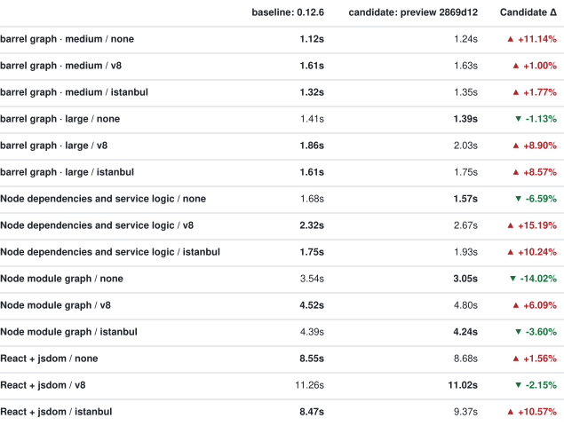

# Rstest version benchmark

Reproducible workloads for comparing Rstest releases and configurations: Node.js, React, Vue, browser mode, worker pools, module graphs, barrels, and coverage.

For Jest / Vitest / Rstest comparisons, see the [main README](../README.md).

## Selected results

<!-- benchmark:versions:start -->

Source: [GitHub Actions](https://github.com/rstackjs/rstest-benchmarks/actions/runs/44030402016), commit `6ebc46edf65eadfe13d080f716d19ef4475f5d0e`, attempt 1.

Sources: baseline: **0.12.6** (npm); candidate: **preview 2869d12** (preview). Measured 2026-11-17 (UTC); Apple M1 (Virtual) × 3; logical CPUs: 3; available parallelism: 3; darwin arm64, Node v26.13.0.

1 warmup(s) and **6 timed runs per supported case**; medians are reported. 10 selected cases. Every candidate percentage is relative to the baseline; negative means less elapsed time.

Sources run sequentially in rotating case/round order. For cases supported by all sources, each source occupies every order position equally often. Node compile cache is disabled. Rstest build and sequencing caches are cleared before each fixture's warmups and retained during measurement. Workload dependency graphs match. Background load and OS page cache are not controlled.

🏆 marks the lowest comparable median in each row. Percentages show change from the baseline. Green marks the row minimum, including ties. Higher values are orange for gaps under 20% and red for gaps of 20% or more.

### Elapsed time (s)

<picture>
<source media="(prefers-color-scheme: dark)" srcset="../reports/charts/versions-elapsed-dark.svg">

</picture>

<details>
<summary>Table data and comparison notes</summary>

| Case | baseline: 0.12.6 | candidate: preview 2869d12 | Δ |
| --- | --- | --- | --- |
| Node startup and utilities | 0.52s | 0.63s | +21.39% |
| Node module graph | 2.73s | 2.78s | +1.85% |
| Node dependencies and service logic | 2.12s | 2.07s | -2.43% |
| React + jsdom | 9.77s | 9.76s | -0.13% |
| React + happy-dom | 5.31s | 4.80s | -9.57% |
| React + browser mode | 5.97s | 6.78s | +13.56% |
| Vue + jsdom | 5.77s | 5.75s | -0.25% |
| Vue + happy-dom | 2.88s | 3.13s | +8.54% |
| Vue + browser mode | 3.25s | 3.59s | +10.71% |
| barrel graph · medium | 1.37s | 1.38s | +0.44% |

</details>

### Memory comparison (MiB, peak process-tree footprint)

<picture>
<source media="(prefers-color-scheme: dark)" srcset="../reports/charts/versions-memory-dark.svg">

</picture>

<details>
<summary>Table data and comparison notes</summary>

| Case | baseline: 0.12.6 | candidate: preview 2869d12 | Δ |
| --- | --- | --- | --- |
| Node startup and utilities | 124.93 | 122.77 | -1.73% |
| Node module graph | 154.70 | 150.49 | -2.72% |
| Node dependencies and service logic | 163.53 | 164.37 | +0.52% |
| React + jsdom | 606.88 | 463.11 | -23.69% |
| React + happy-dom | 364.49 | 297.56 | -18.36% |
| React + browser mode | 362.03 | 365.43 | +0.94% |
| Vue + jsdom | 598.69 | 456.49 | -23.75% |
| Vue + happy-dom | 347.74 | 293.65 | -15.55% |
| Vue + browser mode | 345.86 | 346.22 | +0.10% |
| barrel graph · medium | 137.55 | 135.61 | -1.41% |

</details>

[Full report, variability and inputs](../reports/versions.md). Generated from published samples and compatibility fingerprints; full logs and snapshots are stored separately.

<!-- benchmark:versions:end -->

The [report index](../reports/README.md) links all five comparisons. [Recorded samples](../reports/data/README.md) are included for report verification; full execution artifacts are stored separately.

## Coverage results

<!-- benchmark:coverage:start -->

Source: [GitHub Actions](https://github.com/rstackjs/rstest-benchmarks/actions/runs/43413826291), commit `6560450c5a8b34baff4bd5bc31d3d9f49b4dd661`, attempt 1.

Sources: baseline: **0.11.0** (npm); candidate: **0.12.6** (npm). Measured 2026-11-13 (UTC); Apple M1 (Virtual) × 3; logical CPUs: 3; available parallelism: 3; darwin arm64, Node v26.13.0.

1 warmup(s) and **6 timed runs per supported case**; medians are reported. 15 selected cases. Every candidate percentage is relative to the baseline; negative means less elapsed time.

Sources run sequentially in rotating case/round order. For cases supported by all sources, each source occupies every order position equally often. Node compile cache is disabled. Rstest build and sequencing caches are cleared before each fixture's warmups and retained during measurement. Workload dependency graphs match. Background load and OS page cache are not controlled.

🏆 marks the lowest comparable median in each row. Percentages show change from the baseline. Green marks the row minimum, including ties. Higher values are orange for gaps under 20% and red for gaps of 20% or more.

### Elapsed time (s)

<picture>
<source media="(prefers-color-scheme: dark)" srcset="../reports/charts/coverage-elapsed-dark.svg">

</picture>

<details>
<summary>Table data and comparison notes</summary>

| Case | baseline: 0.11.0 | candidate: 0.12.6 | Δ |
| --- | --- | --- | --- |
| barrel graph · medium / none | 1.09s | 1.16s | +6.79% |
| barrel graph · medium / v8 | 1.87s | 1.73s | -7.70% |
| barrel graph · medium / istanbul | 1.53s | 1.29s | -15.58% |
| barrel graph · large / none | 1.50s | 1.50s | -0.33% |
| barrel graph · large / v8 | 2.41s | 2.25s | -6.71% |
| barrel graph · large / istanbul | 2.05s | 1.70s | -17.33% |
| Node dependencies and service logic / none | 1.85s | 2.32s | +25.41% |
| Node dependencies and service logic / v8 | 3.14s | 2.92s | -7.00% |
| Node dependencies and service logic / istanbul | 2.65s | 2.28s | -13.77% |
| Node module graph / none | 2.43s | 2.40s | -1.35% |
| Node module graph / v8 | 4.69s | 4.13s | -11.87% |
| Node module graph / istanbul | 4.13s | 3.54s | -14.34% |
| React + jsdom / none | 11.99s | 10.30s | -14.14% |
| React + jsdom / v8 | 15.20s | 12.40s | -18.40% |
| React + jsdom / istanbul | 12.04s | 10.77s | -10.54% |

</details>

### Memory comparison (MiB, peak process-tree footprint)

<picture>
<source media="(prefers-color-scheme: dark)" srcset="../reports/charts/coverage-memory-dark.svg">

</picture>

<details>
<summary>Table data and comparison notes</summary>

| Case | baseline: 0.11.0 | candidate: 0.12.6 | Δ |
| --- | --- | --- | --- |
| barrel graph · medium / none | 130.13 | 137.65 | +5.78% |
| barrel graph · medium / v8 | 166.20 | 148.49 | -10.66% |
| barrel graph · medium / istanbul | 181.99 | 169.06 | -7.10% |
| barrel graph · large / none | 140.07 | 145.18 | +3.64% |
| barrel graph · large / v8 | 176.35 | 158.93 | -9.88% |
| barrel graph · large / istanbul | 193.49 | 176.88 | -8.59% |
| Node dependencies and service logic / none | 164.19 | 165.59 | +0.86% |
| Node dependencies and service logic / v8 | 186.43 | 178.27 | -4.38% |
| Node dependencies and service logic / istanbul | 204.62 | 200.90 | -1.82% |
| Node module graph / none | 156.94 | 154.58 | -1.50% |
| Node module graph / v8 | 270.91 | 218.68 | -19.28% |
| Node module graph / istanbul | 272.56 | 244.66 | -10.24% |
| React + jsdom / none | 503.69 | 598.55 | +18.83% |
| React + jsdom / v8 | 666.48 | 604.18 | -9.35% |
| React + jsdom / istanbul | 512.04 | 629.39 | +22.92% |

</details>

[Full report, variability and inputs](../reports/coverage.md). Generated from published samples and compatibility fingerprints; full logs and snapshots are stored separately.

<!-- benchmark:coverage:end -->

## Compare versions

Use Node.js 26 and the pnpm version pinned in `package.json`. Run from the repository root:

```sh
# Two npm releases
pnpm compare --baseline 0.12.5 --candidate 0.12.6

# npm release vs local source (replace the checkout path)
pnpm compare --baseline 0.12.6 --candidate local:../rstest
```

Both sides accept an exact npm version, a commit-addressed pkg.pr.new Rstest link, or `local:<path>`. The command installs dependencies, builds local sources, and installs Chromium when needed. No manual version switching or separate build is required.

By default, it runs the **main suite**, with **1 warmup + 5 timed runs per case**, alternating versions each round. Node compile cache is disabled. Open the printed `results/<comparison>/README.md` for the report; samples and logs are retained alongside it.

| Add to either command | Purpose |
| --- | --- |
| `--cases node-backend` | Compare one workload across selected suites |
| `--exclude-cases vue-spa` | Skip all Vue cases; full case IDs can target individual variants |
| `--suites all` | Include scaling, barrels, worker pools, and coverage/memory |
| `--runs 10` | Collect more samples |

`compare` leaves this page unchanged by default. Add `--update-readme` to publish the selected suites, including their samples, reports, and measurement notes. Failed comparisons do not publish.

```sh
# Compare multiple candidates against one baseline
pnpm compare --baseline 0.12.4 --candidate 0.12.5,0.12.6 --runs 6

# Run all suites and update README/report data
pnpm compare --baseline 0.12.5 --candidate 0.12.6 --suites all --runs 6 --update-readme
```

Repeat `--candidate` to mix npm, preview and local sources. With N total sources, use a multiple of N timed runs to balance order positions. See [all options and publication behavior](../docs/running.md#compare-versions).

## Run in CI

In **Actions**, choose [Rstest version benchmark](../.github/workflows/benchmark-versions.yml) for the main comparison shown below (scaling, barrel and pools are opt-in through `suites`), or [Rstest coverage benchmark](../.github/workflows/benchmark-version-coverage.yml) for coverage and memory. Enable `memory` on the version workflow to measure peak process-tree footprint alongside elapsed time. Coverage measures footprint automatically. Both workflows accept baseline/candidate npm versions or pkg.pr.new Rstest links, and the repetition count (both run on macOS), defaulting to six timed runs per case. Coverage includes fresh no-coverage controls on the same host. To publish either successful run after extracting its artifact under `results/`:

```sh
pnpm report:versions --input results/<comparison>/comparison.json
pnpm report:check
```

This updates only the selected suites on this page and in the version reports. Importing performance and coverage artifacts separately preserves the other tables and each run’s host information; samples from the two hosts are not merged. The framework comparison homepage stays unchanged. See [CI and report publication](../docs/ci.md).

## Suites

| Command | Measures | Results |
| --- | --- | --- |
| `pnpm bench` | Node workloads; React and Vue in jsdom, happy-dom, and browser mode (Chromium); a medium barrel graph | [Main](../reports/versions.md) |
| `pnpm bench:scaling` | File count and module graph size, varied independently | [Scaling](../reports/scaling.md) |
| `pnpm bench:pools` | Node worker pool modes across three suite sizes | [Pools](../reports/pools.md) |
| `pnpm bench:barrel` | Lazy-barrel eligibility across three graph sizes | [Barrels](../reports/barrel.md) |
| `pnpm bench:coverage` | No coverage, V8, and Istanbul overhead, including memory | [Coverage](../reports/coverage.md) |

All commands accept `--list` and `--runs`. See [workload design](../docs/workloads.md) for fixture sizes and controlled variables.

## Measurement

- Whole-process elapsed time, including CLI, build, workers/browser, tests, and reporting. By default, one warmup precedes five timed runs; the median is reported.
- Node compile cache is disabled. Rstest caches are retained between timed runs, so these results do not represent a fresh CI job with no history.
- Default worker concurrency and `forks + isolate:true` for Node/DOM, except in the pool suite. Coverage memory is the peak process-tree physical footprint on macOS (see [Memory methodology](../README.md#methodology)).
- All samples are retained. Reports include variability and unsupported cases; small differences and results from different machines or workloads need separate verification.

See [measurement details and result format](../docs/results.md) for cache policy, comparison checks, and statistics.
